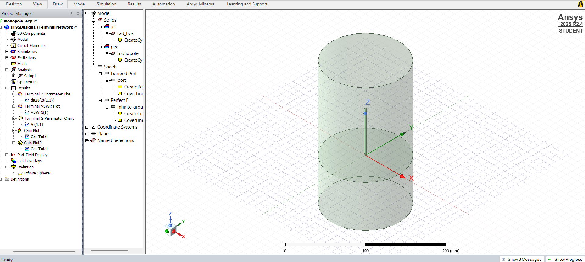
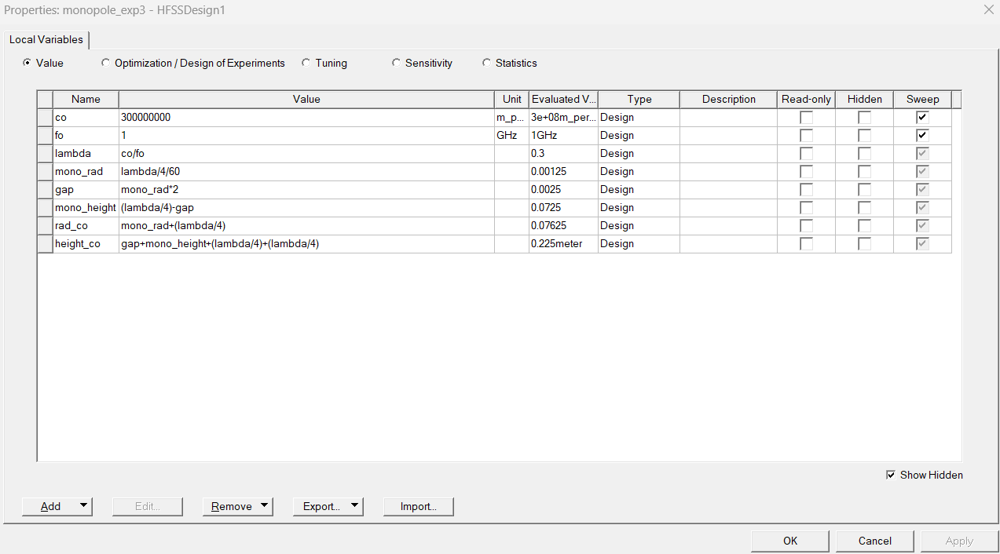
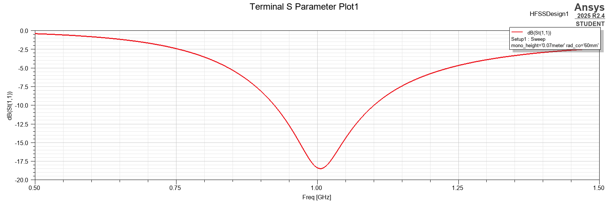
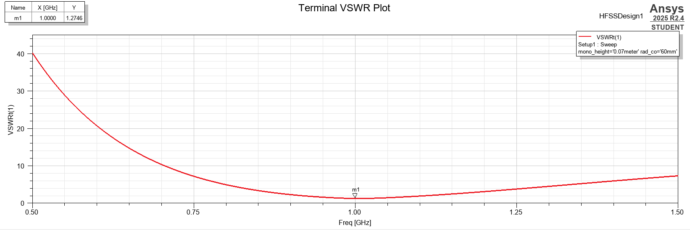
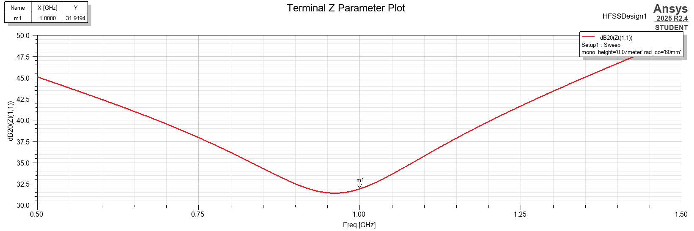
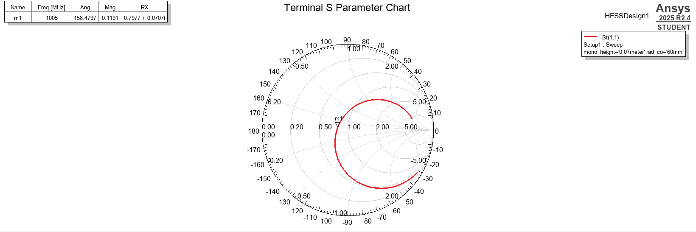
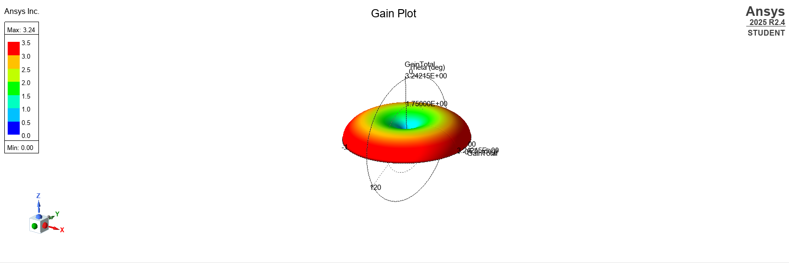
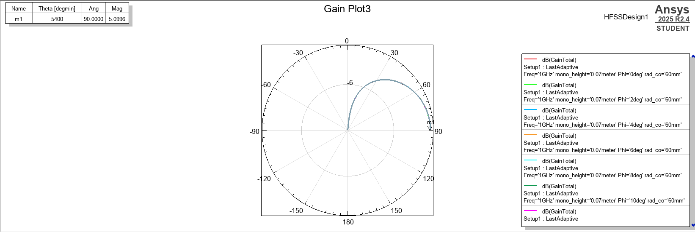

# Quarter-Wave Monopole Antenna at 1 GHz

Design and simulation of a 1 GHz quarter-wave monopole antenna over a ground plane, in Ansys Electronics Desktop (HFSS) Student 2025 R2.4, using a Terminal network solution.

## Design equations
- Wavelength: λ = c / f = 3e8 / 1e9 = 0.3 m
- Quarter wavelength: λ/4 = 75 mm
- Monopole radius: λ/240 = 1.25 mm (thin wire)
- Feed gap: 2 × monopole radius = 2.5 mm
- Monopole height tuned to 70 mm to place the resonance at 1 GHz

## Parameters
| Variable | Value |
|---|---|
| Frequency | 1 GHz |
| mono_height | 70 mm |
| mono_rad | 1.25 mm |
| gap | 2.5 mm |
| rad_co (ground plane and radiation box radius) | 60 mm |

## Results
| Metric | Value |
|---|---|
| Resonant frequency | about 1.005 GHz |
| Return loss (S11) | -18.48 dB |
| VSWR at 1 GHz | 1.27 |
| Input impedance near 1 GHz | about 39 + j1 Ω |
| Peak gain | about 5.1 dBi (3.24 linear) |

The input impedance is slightly below 50 Ω, which is typical for a quarter-wave monopole over a finite ground plane. The radiation pattern is a donut, with a null along the monopole axis and maximum radiation toward the horizon.

## Plots

### Model

### Design variables

### Return loss (S11)

### VSWR

### Input impedance

### Smith chart

### 3D gain pattern

### E-plane pattern

## Notes
- One variable (rad_co) sets both the ground plane and the radiation boundary in this model.
- The project file is not included; all design parameters are listed above so the model can be recreated in HFSS.

## Future work
- Parametric and optimization studies of height and ground plane size
- H-plane pattern and bandwidth measurement
